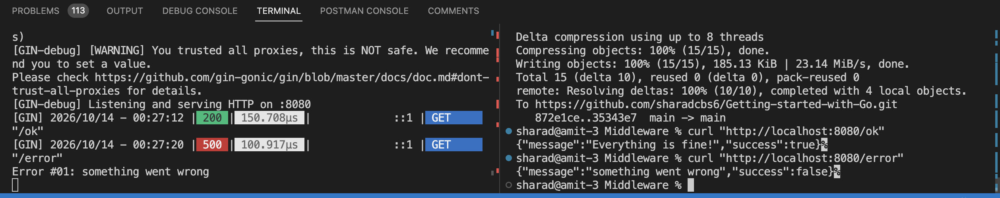
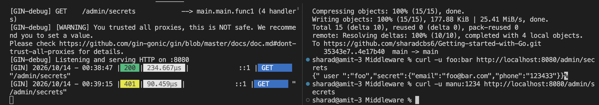
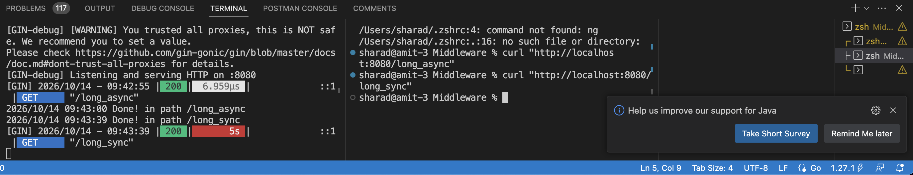
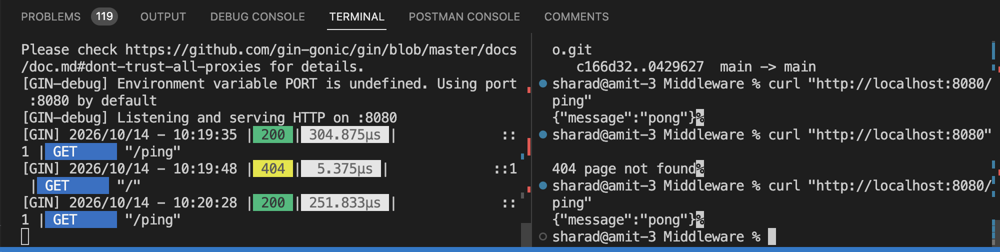
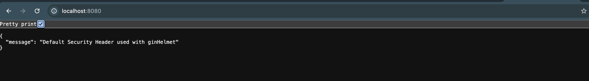
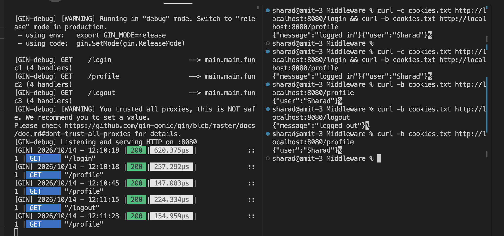
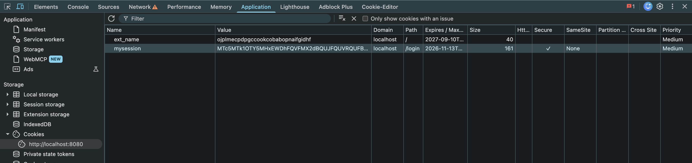

# Output
## withoutMiddleare.go

## using Midddleware.go

## customMiddleware.go

## customRecoveryBehaviour.go

## ErrorHandlingMiddleware.go

## basicAuthMiddleware.go

## Goroutines.go

## SecruityHeaders.go

## DefaultSecruityHeaders.go
     

## SessionManagement.go

